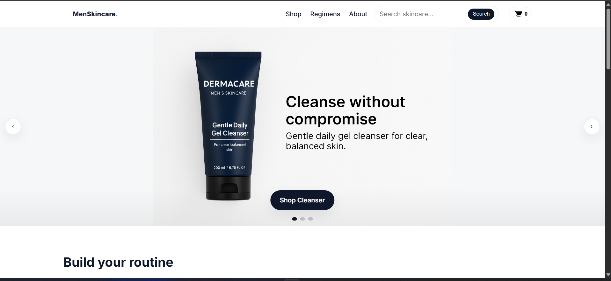
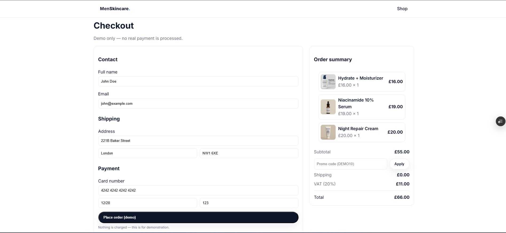

# Web-project-2.0
Men’s Skincare Website

This is a demo e-commerce website designed for a men’s skincare brand. It was built as a redesign of my university final year project and developed further to showcase my front-end skills and ability to integrate a lightweight backend.

🔗 Live site: https://web-project-2-0.vercel.app/

## ✨Features

- Fully responsive layout built with HTML, CSS and JavaScript  
- Product catalogue with shopping cart and checkout flow  
- Hero carousel with custom controls  
- Serverless API for storing orders (Vercel Functions + Upstash Redis)  

## 🛠️Tech stack

- **Frontend:** HTML5, CSS3, Vanilla JavaScript  
- **Backend:** Vercel Functions  
- **Database:** Upstash Redis  
- **Deployment:** Vercel  

## 📸Sneakpeek

Notes

This project is for demo purposes only checkout and payment are mock implementations.